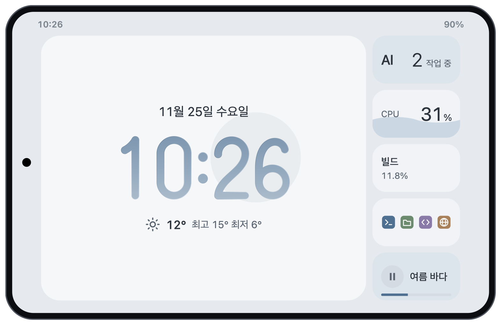
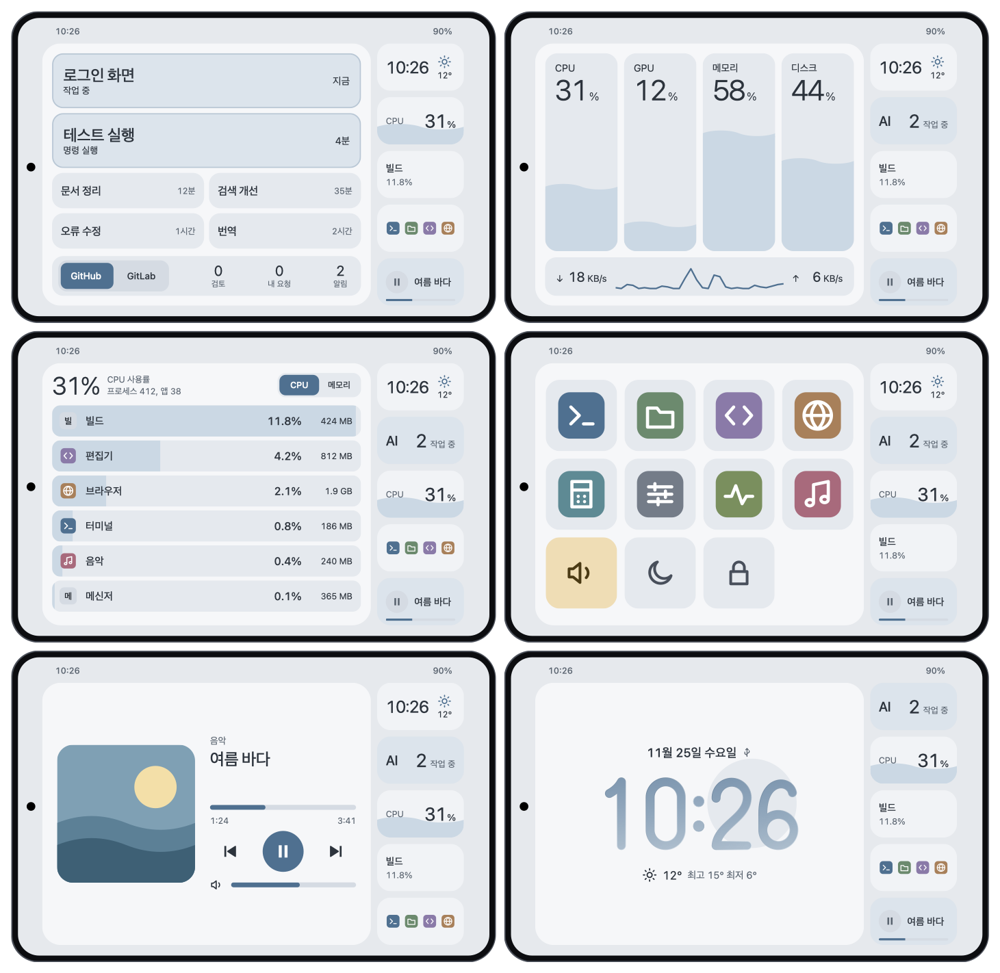
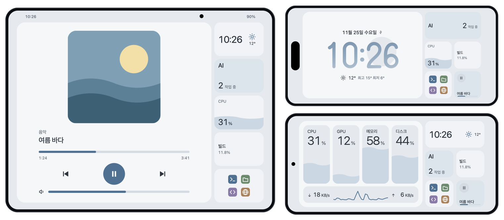

<h1 align="center">SideDesk</h1>

<b>컴퓨터 옆에 세워 둔 스마트폰을 상태 화면 겸 조작판으로</b>

  <picture>
    <source media="(prefers-color-scheme: dark)" srcset="docs/images/hero-dark.png">
    
  </picture>

> **개발 초기입니다.** 아직 내려받아 쓸 수 있는 버전이 없습니다. 이 페이지의 그림은 예시 데이터를 넣은 디자인 시안이고, 기능은 모두 계획입니다.

AI 코딩 작업을 여러 개 돌리면 무엇이 끝났고 무엇이 답을 기다리는지 창을 옮겨 다니며 확인하게 됩니다. SideDesk는 그 상태를 옆에 둔 폰에 띄워 둡니다. 하던 창은 그대로 두고 옆을 보면 됩니다.

## 할 수 있는 일

| 화면 | 폰에서 보는 것 | 폰에서 하는 것 |
|---|---|---|
| **홈** | 시계, 날짜, 날씨, 연결 상태 | 시계 모양과 테마 고르기 |
| **AI 세션** | 작업별 진행 상태 | 끝남과 답변 대기 알림 받기 |
| **성능** | CPU, GPU, 메모리, 디스크, 네트워크 | |
| **프로세스** | 많이 쓰는 프로그램 | 프로그램 종료 |
| **단축키** | 등록한 버튼 | 컴퓨터의 앱과 명령 실행 |
| **음악** | 재생 중인 곡 | 재생, 곡 넘기기, 볼륨 |

  <picture>
    <source media="(prefers-color-scheme: dark)" srcset="docs/images/screens-dark.png">
    
  </picture>

## 화면 원칙

- **하나는 크게, 나머지는 작게.** 작은 칸도 계속 움직이고, 누르면 커집니다.
- **저절로 넘어가지 않습니다.** 보고 있는 화면은 직접 바꿀 때만 다른 화면으로 바뀝니다.
- **눈이 편한 두 테마.** 밝은 테마와 어두운 테마를 직접 고릅니다.
- **쉴 때는 검은 화면.** 오래 쓰지 않으면 시계만 어둡게 남깁니다.

  <picture>
    <source media="(prefers-color-scheme: dark)" srcset="docs/images/devices-dark.png">
    
  </picture>

접는 폰, 아이폰, 바형 안드로이드 폰에 맞춘 시안

## 동작 방식

  <picture>
    <source media="(prefers-color-scheme: dark)" srcset="docs/images/flow-dark.png">
    
  </picture>

- 폰에 보이는 정보만 모읍니다. 연결된 폰이 없으면 수집을 멈춥니다.
- 컴퓨터와 폰을 직접 잇습니다. 회원 가입과 중간 서버가 없습니다.

## 보안과 개인 정보

- 처음 한 번 짝을 맺고, 짝을 맺은 기기끼리만 암호화해서 통신합니다.
- 폰은 미리 등록한 명령만 실행할 수 있습니다.
- 사용 기록을 모으거나 보내지 않습니다.
- 인터넷은 날씨와, GitHub 또는 GitLab 알림을 켰을 때만 씁니다.

## 지원 계획

| | USB | 블루투스 | 상태 |
|---|---|---|---|
| macOS | 계획 | 계획 | 1단계 준비 중 |
| Windows | 계획 | 방식 찾는 중 | 계획 |
| Android | 계획 | 계획 | 계획 |
| iOS | 계획 | 계획 | 계획 |

## 개발 순서

- [ ] 공용 코어, 짝 맺기, USB 연결
- [ ] macOS 정보 수집과 명령 실행
- [ ] Android 화면
- [ ] 블루투스 연결 (macOS)
- [ ] Windows
- [ ] iOS
- [ ] 배포

## 만드는 데 쓰는 것

컴퓨터 프로그램과 공용 코어는 **Rust**, Android 앱은 **Kotlin**, iOS 앱은 **Swift** 로 만듭니다.
