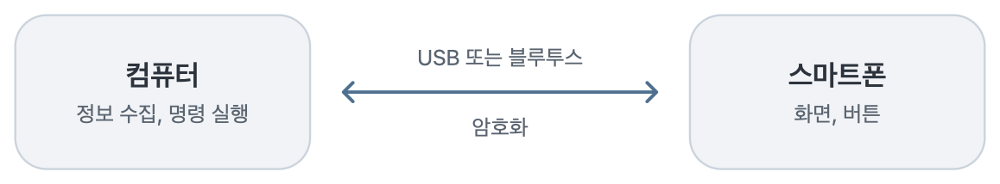

<h1 align="center">SideDesk</h1>

<b>컴퓨터 옆에 세워 둔 스마트폰을 상태 화면 겸 조작판으로</b>

  <picture>
    <source media="(prefers-color-scheme: dark)" srcset="docs/images/hero-dark.png">
    
  </picture>

> **개발 초기입니다.** 아직 내려받아 쓸 수 있는 버전이 없습니다. 이 페이지의 그림은 예시 데이터를 넣은 디자인 시안이고, 기능은 모두 계획입니다.

AI 코딩 작업을 여러 개 돌리면 무엇이 끝났고 무엇이 답을 기다리는지 창을 옮겨 다니며 확인하게 됩니다. SideDesk는 그 상태를 옆에 둔 폰에 띄워 둡니다. 하던 창은 그대로 두고 옆을 보면 됩니다.

## 할 수 있는 일

| 화면 | 폰에서 보는 것 | 폰에서 하는 것 |
|---|---|---|
| **홈** | 시계, 날짜, 날씨, 연결 상태 | 시계 모양과 테마 고르기 |
| **AI 세션** | 작업별 진행 상태 | 끝남과 답변 대기 알림 받기 |
| **성능** | CPU, GPU, 메모리, 디스크, 네트워크 | |
| **프로세스** | 많이 쓰는 프로그램 | 프로그램 종료 |
| **단축키** | 등록한 버튼 | 컴퓨터의 앱과 명령 실행 |
| **음악** | 재생 중인 곡 | 재생, 곡 넘기기, 볼륨 |

  <picture>
    <source media="(prefers-color-scheme: dark)" srcset="docs/images/screens-dark.png">
    
  </picture>

## 화면 원칙

- **하나는 크게, 나머지는 작게.** 작은 칸도 계속 움직이고, 누르면 커집니다.
- **저절로 넘어가지 않습니다.** 보고 있는 화면은 직접 바꿀 때만 다른 화면으로 바뀝니다.
- **눈이 편한 두 테마.** 밝은 테마와 어두운 테마를 직접 고릅니다.
- **쉴 때는 검은 화면.** 오래 쓰지 않으면 시계만 어둡게 남깁니다.
- **확인은 공통 창으로.** 끝내기처럼 되돌릴 수 없는 일은 앱 전체가 같은 모양의 확인 창 하나로 묻습니다.

  <picture>
    <source media="(prefers-color-scheme: dark)" srcset="docs/images/devices-dark.png">
    
  </picture>

접는 폰, 아이폰, 바형 안드로이드 폰에 맞춘 시안

## 동작 방식

  <picture>
    <source media="(prefers-color-scheme: dark)" srcset="docs/images/flow-dark.png">
    
  </picture>

- 폰에 보이는 정보만 모읍니다. 연결된 폰이 없으면 수집을 멈춥니다.
- 컴퓨터와 폰을 직접 잇습니다. 회원 가입과 중간 서버가 없습니다.

## 보안과 개인 정보

- 처음 한 번 짝을 맺고, 짝을 맺은 기기끼리만 암호화해서 통신합니다.
- 폰은 미리 등록한 명령만 실행할 수 있습니다.
- 사용 기록을 모으거나 보내지 않습니다.
- 인터넷은 날씨와, GitHub 또는 GitLab 알림을 켰을 때만 씁니다.

## 설치

배포 파일은 저장소의 Actions 산출물로 만듭니다. 공개 배포 전에는 직접 빌드하거나 산출물을 받습니다. Actions 산출물은 언제나 zip 으로 내려받으니 풀어서 안의 파일을 씁니다.

### macOS

1. `SideDesk-<버전>-mac.dmg` 를 열고 SideDesk 를 응용 프로그램 폴더로 끌어 놓습니다. 애플 칩과 인텔 맥에서 모두 돕니다.
2. 처음 열면 macOS 가 막습니다(15 이상: "Apple 은 … 확인할 수 없습니다", 14 이하: "확인되지 않은 개발자"). 애플 개발자 서명과 공증을 하지 않아서입니다.
   - macOS 15 이상: 한 번 열기를 누른 뒤 시스템 설정 > 개인정보 보호 및 보안 맨 아래의 "그래도 열기"를 누릅니다.
   - macOS 14 이하: Finder 에서 SideDesk 를 오른쪽 클릭하고 "열기"를 누릅니다.
3. 메뉴 막대에 SideDesk 아이콘이 생깁니다. 설정 창을 닫아도 계속 돌고, 아이콘 메뉴의 "설정 열기"와 "끝내기"로 다룹니다.
4. 처음 쓸 때 권한 창이 뜰 수 있습니다.
   - 블루투스: 케이블 없이 폰과 연결할 때
   - 자동화(음악, Spotify): 재생 중인 곡을 폰에 보이고 조작할 때
   - 손쉬운 사용: 단축키의 키 조합과 화면 잠금을 쓸 때
5. 새 판으로 바꿔 깔면 블루투스와 자동화 권한을 다시 묻습니다. 개발자 서명이 없어 macOS 가 새 앱으로 보기 때문입니다. 손쉬운 사용은 다시 묻지 않고 예전 항목이 켜진 채 듣지 않으니, 시스템 설정 > 개인정보 보호 및 보안 > 손쉬운 사용에서 SideDesk 를 지우고(−) 다시 넣습니다.

직접 빌드: `scripts/dist-mac.sh` 가 `target/dist/` 에 .dmg 를 만들고, 비밀값과 개인 경로가 들어 있지 않은지 검사합니다.

### Windows

1. Actions 산출물 zip 을 풀면 나오는 `SideDesk-<버전>-windows-x64.zip` 을 다시 풀어 원하는 폴더에 둡니다. 윈도우 10, 11(64비트)에서 돕니다.
2. `sidedesk.exe` 가 설정 창입니다. 창을 닫아도 알림 영역(시스템 트레이) 아이콘으로 계속 돌고, 아이콘 메뉴의 "설정 열기"와 "끝내기"로 다룹니다.
3. 코드 서명을 하지 않아 처음 열 때 SmartScreen 창이 뜨면 "추가 정보 > 실행"을 누릅니다.
4. 터미널에서는 `sidedesk-cli.exe` 를 씁니다. `sidedesk-cli pair` 는 기기 등록, `sidedesk-cli run` 은 창 없이 연결 유지입니다.
5. 설정 창은 WebView2 런타임을 씁니다. 윈도우 10, 11 에는 대개 깔려 있고, 없으면 Microsoft 에서 받아 깝니다.

직접 빌드: `pwsh scripts/dist-windows.ps1` 이 `target\dist\` 에 zip 을 만들고, 비밀값과 개인 경로가 들어 있지 않은지 검사합니다.

### Android

1. 안드로이드 10 이상, 64비트 ARM(arm64) 폰에서 돕니다.
2. 배포하는 곳에서 받은 `SideDesk-<버전>.apk` 를 폰에서 열어 설치합니다. 처음이면 "출처를 알 수 없는 앱 설치"를 허용합니다. 컴퓨터에서 `adb install SideDesk-<버전>.apk` 로 깔아도 됩니다.
3. Actions 산출물 zip 을 풀면 나오는 `SideDesk-<버전>-unsigned.apk` 는 서명이 없어 그대로는 설치되지 않습니다. 자기 키로 서명하거나(`apksigner sign --ks <키스토어> SideDesk-<버전>-unsigned.apk`), 직접 빌드합니다.
   - 직접 빌드: `cd android && ./gradlew assembleRelease`. 환경변수(또는 홈의 `~/.gradle/gradle.properties`)에 `SIDEDESK_KEYSTORE`, `SIDEDESK_KEYSTORE_PASSWORD`, `SIDEDESK_KEY_ALIAS`, `SIDEDESK_KEY_PASSWORD` 가 있으면 그 키로 서명하고, 없으면 개발용 디버그 키로 서명한 `-debugkey.apk` 가 나옵니다.
   - 서명한 키가 다른 APK 로는 덮어 설치할 수 없습니다. 지우고 다시 설치해야 하고, 그러면 짝 맺기를 다시 합니다.
4. 케이블로 쓰려면 폰의 개발자 옵션에서 USB 디버깅을 켭니다(컴퓨터 프로그램이 adb 로 잇습니다). 블루투스는 따로 할 일이 없고, 처음 열 때 블루투스 권한을 묻습니다.
5. 날씨에 쓸 대략 위치를 처음에 한 번 묻습니다. 거절하면 날씨 자리만 `--°` 로 비고 나머지는 그대로 씁니다.

## 지원 계획

| | USB | 블루투스 | 상태 |
|---|---|---|---|
| macOS | 계획 | 계획 | 1단계 준비 중 |
| Windows | 계획 | 방식 찾는 중 | 계획 |
| Android | 계획 | 계획 | 계획 |
| iOS | 계획 | 계획 | 계획 |

## 개발 순서

- [ ] 공용 코어, 짝 맺기, USB 연결
- [ ] macOS 정보 수집과 명령 실행
- [ ] Android 화면
- [ ] 블루투스 연결 (macOS)
- [ ] Windows
- [ ] iOS
- [ ] 배포

## 만드는 데 쓰는 것

컴퓨터 프로그램과 공용 코어는 **Rust**, Android 앱은 **Kotlin**, iOS 앱은 **Swift** 로 만듭니다.

Android 앱에서 새 확인 창은 직접 짜지 않고 `ConfirmModal`(`android/app/src/main/kotlin/io/github/hyeonsikoh/sidedesk/ui/ConfirmModal.kt`)을 씁니다.
